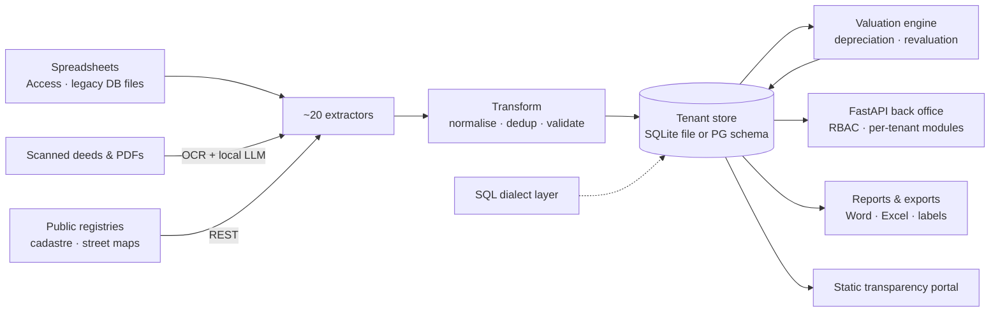

# Multi-Tenant Asset Register

A multi-tenant platform that consolidates public-sector fixed-asset inventories from decades of
heterogeneous sources, values and depreciates every asset with an auditable trail, and replaces a
legacy desktop accounting system **matching its figures to the cent**. Built at **Intervalor Data**
(2026).

> This repository is a **case study plus a clean-room reimplementation** of selected patterns.
> It contains no client code, data, names or infrastructure details. All sample data is synthetic.

---

## Context

- Local public administrations must keep a legally defined register of everything they own
  (buildings, land, roads, vehicles, furniture, heritage), valued and depreciated, and reconciled
  with their accounts.
- In practice that register lived in spreadsheets, scanned deeds, an old Access database and, for
  many organisations, a **decades-old legacy desktop application** whose file format and
  calculation rules were the only specification.
- Each organisation is a separate tenant with its own chart of accounts, useful-life tables and
  history. Reports were assembled by hand.
- Replacing the legacy system was acceptable only if the year-end figures came out **identical**:
  an auditor compares totals, not intentions.

## My role

Architect and lead developer, end to end: data model, ETL, valuation engine, multi-tenant
storage, web back office, security, packaging and production operations. I worked with the
valuation experts and the accounting team to turn their criteria into code, and with each
tenant's data to make migrations reconcile. **~1,100 commits in ~8 months, 29 decision records.**

## Architecture



**Why this shape:** the product started as a single-file SQLite app that could also be handed to a
tenant as a Windows executable. When the service had to host dozens of tenants on one server, I
kept the raw SQL and added a **thin dialect layer** that runs the same statements on PostgreSQL,
with one schema per tenant. ~1,200 SQL call sites in ~90 files moved to the new engine without
being rewritten, and the single-file mode still works for on-premise deployments.

## Key decisions

| Decision | Rejected alternative | Why |
|---|---|---|
| One schema per tenant (`SET search_path`) | Shared tables with a `tenant_id` column | Maps 1:1 to the original file-per-tenant model, so queries did not change; a cross-tenant leak needs more than one forgotten `WHERE` |
| Runtime SQL dialect translation | Full ORM rewrite, or two hand-written SQL dialects | ~1,200 raw statements; an ORM rewrite meant months of risk, two dialects meant permanent drift |
| `Decimal`, half-up to the cent, legacy month convention | Floats and the library's default rounding | The legacy totals were the acceptance test; a one-cent drift per asset is a failed audit |
| Every figure carries a *calculation memo* (source of each input, rule applied) | A number plus documentation elsewhere | Valuations must be justified; the memo answers "why this number?" without reading code |
| Balances from an approved closing are loaded, not recomputed | Recompute everything with the new engine | The register must agree with accounts that were already signed off |
| Vendor support access via RS256-signed tokens | A seeded super-admin row in each tenant's database | No credential stored at the client to read or brute-force offline; the private key never leaves the vendor |
| Same container stack on an on-premise server, cloud postponed | Managed cloud database from day one | Cloud provider choice still open; with the same stack, moving later is a database dump, not a redesign |
| Per-tenant feature flags for optional modules | Separate builds per customer | One codebase; modules are sold and switched on per tenant |

## Results

| Area | Before | After |
|---|---|---|
| Legacy migrations | — | **15+ tenants** migrated, each reconciled to the cent per account (cost, accumulated depreciation, net value) |
| Tenants on one server | One file per tenant on a workstation | **~35 tenant schemas** on a single PostgreSQL instance |
| Annual revaluation vs. the legacy system | ~60 % of assets matched | **100 %** of a ~2,300-asset tenant matched, Δ 0.00 (see lesson 05) |
| Technical reports per tenant | 3–8 h by hand | **10–15 min** generated |
| Feature parity with the legacy application | ~80 % | **>90 %** |
| Automated tests | ~390 (API endpoints untested) | **~1,900** |
| Documents made searchable | Scanned folders | **~10k** documents indexed, ~97 % with extracted text |

## Engineering practices

- **Golden comparisons against legacy closings**: per-asset and per-account comparison scripts run
  before a migrated tenant is opened to users; it is not declared done until the delta is zero.
- **Dual-engine test harness**: the suite can run against PostgreSQL as well as SQLite, which
  surfaced parity bugs no unit test had caught (lesson 04).
- **Dry-run by default** for every bulk operation on money; each real run writes a per-asset audit
  log and refuses to run twice for the same year (lesson 05).
- **Security**: role-based permissions per back-office section enforced on API, pages and
  navigation; CSRF double-submit on every write; tenant ids validated before they reach a path or
  a schema name; a self-run OWASP Top 10 review turned into a prioritised remediation plan
  (lesson 07).
- **Backups before touching data**: every manual data operation starts with a dated snapshot
  named after its purpose.
- **Docs as code**: 29 decision records, a changelog, per-module runbooks and a migration playbook
  so another engineer can onboard a tenant.

## Lessons

- [A failed SELECT poisoned the whole PostgreSQL transaction](docs/lessons/01-aborted-transaction.md)
- [Escape `%` only when parameters are passed](docs/lessons/02-percent-escaping.md)
- [Bulk load with explicit ids, then every INSERT failed](docs/lessons/03-sequences-after-bulk-load.md)
- [One direct `connect()` opened an empty ghost database](docs/lessons/04-ghost-database.md)
- [Revaluation coefficients compound, and the missing term](docs/lessons/05-coefficients-compound.md)
- [Same account code, different meaning](docs/lessons/06-same-code-different-meaning.md)
- [The role check allowed promoting yourself](docs/lessons/07-role-escalation.md)

## Demo

Three clean-room modules, standard library only, **33 tests**. Mutation-checked: switching to
banker's rounding, dropping the revaluation of accumulated depreciation, always escaping `%` or
skipping the tenant check each make a test fail.

- [`src/sql_dialect.py`](src/sql_dialect.py) — translates SQLite statements to PostgreSQL:
  literal-aware `?`→`%s`, `%` escaping only with parameters, `INSERT OR IGNORE/REPLACE`→
  `ON CONFLICT` (refusing to guess a conflict key), date functions, DDL. Plus tenant-id resolution
  and a validated `search_path`.
- [`src/depreciation.py`](src/depreciation.py) — straight-line depreciation with half-up cents,
  inclusive month convention, land excluded from the base without double-counting the residual,
  non-depreciable rules ordered before data gaps, a calculation memo on every result, and an
  **idempotent** annual revaluation by coefficient.
- [`src/reconcile.py`](src/reconcile.py) — per-account comparison against a legacy closing that
  treats one cent as a failure and points at the assets most likely responsible.

```bash
python -m unittest discover -s tests -v     # Python >= 3.10, no dependencies
```

## Stack

Python (FastAPI, Jinja2, Pydantic, pandas, openpyxl, python-docx, reportlab, Babel) · SQLite ·
PostgreSQL (schema-per-tenant, full-text search) · Tesseract OCR · local LLM inference · Docker ·
PyInstaller + Windows installer · pytest · ruff · mypy · Markdown decision records.

> Disclaimer: clean-room reimplementation; no client code or data.
